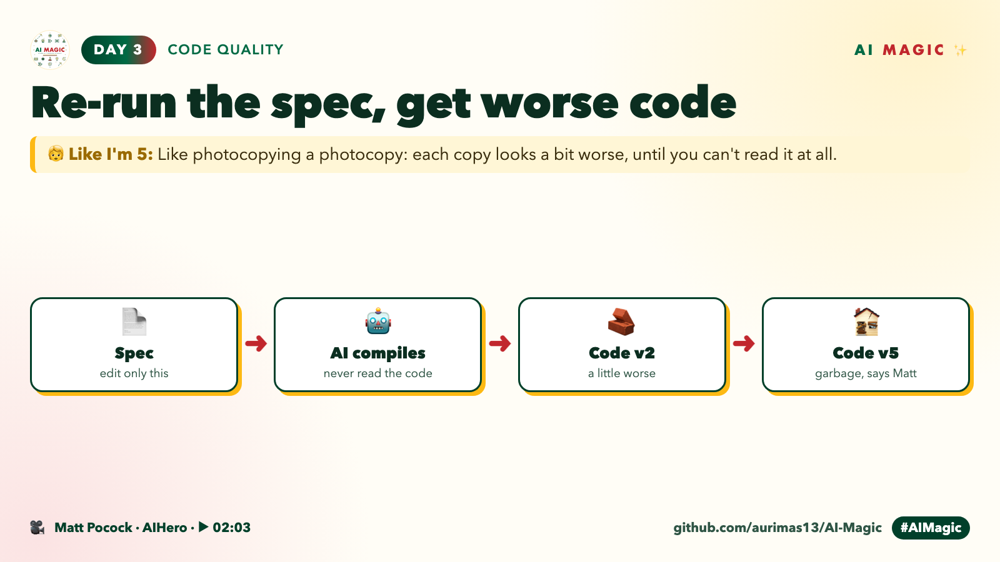
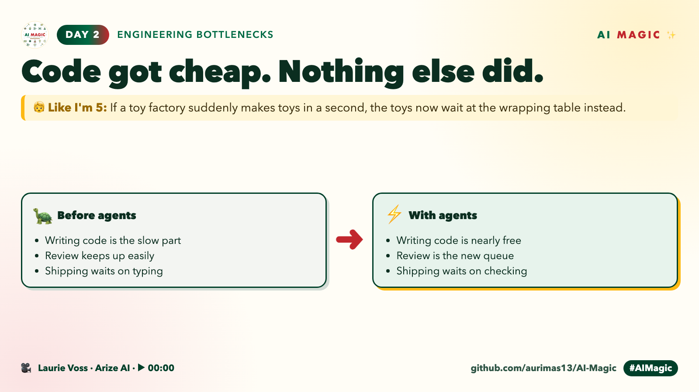
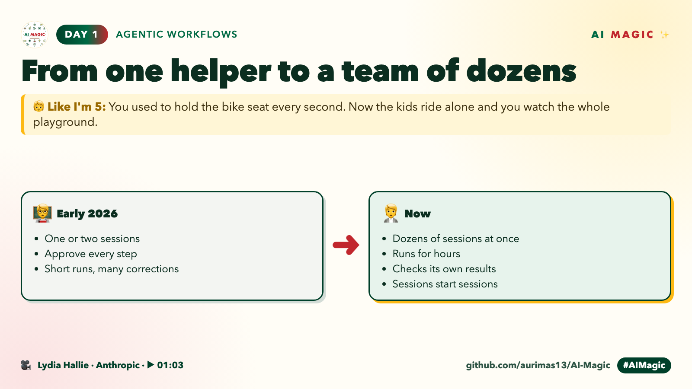

<h1 align="center">AI Magic Gallery</h1>

Every day card published so far, newest first: the picture that went out that morning on X, Bluesky,
Threads and LinkedIn under <b>#AIMagic</b>. Each card opens its day note, with the source, the timestamp and the full lesson.

<a href="README.md">← Back to the README</a> · <a href="README.md#daily-magic">Daily Magic table</a> · <a href="assets/cards/">All card files</a>

<b>November 2026</b> · 3 cards

<table>
<tr>
<td width="33%" valign="top" align="center"> <b>Day 3 · <a href="days/day-003.md">Re-run the spec, get worse code</a></b> Like photocopying a photocopy: each copy looks a bit worse, until you can't read it at all.</td>
<td width="33%" valign="top" align="center"> <b>Day 2 · <a href="days/day-002.md">Code got cheap. Nothing else did.</a></b> If a toy factory suddenly makes toys in a second, the toys now wait at the wrapping table instead.</td>
<td width="33%" valign="top" align="center"> <b>Day 1 · <a href="days/day-001.md">From one helper to a team of dozens</a></b> You used to hold the bike seat every second. Now the kids ride alone and you watch the whole playground.</td>
</tr>
</table>

 

Cards are 1600x900 PNGs under the repository's <a href="LICENSE">MIT licence</a>: reuse them in a talk, a wiki or a lesson, with a link back.
Drawn with Claude Code from a fixed template and reviewed by me before publishing, see <a href="README.md#ai-collaboration">AI Collaboration</a>.
