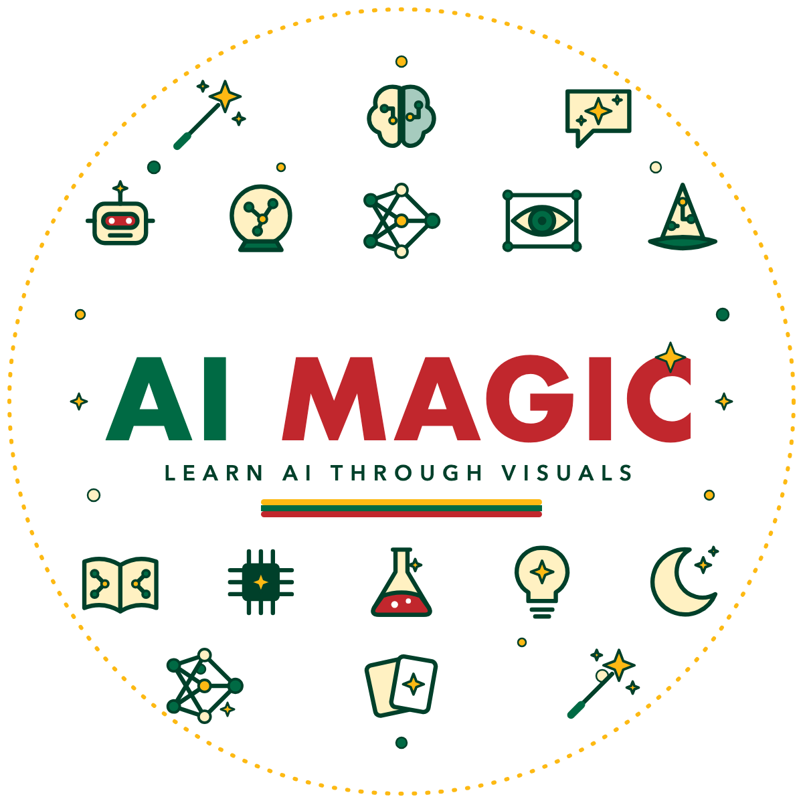

  

<b>AI Magic</b>: one lesson a day on <b>current AI and ML</b>, drawn as a picture and explained <b>to you like you are five</b>.

<b>Overview & Next Move</b>

AI is moving faster than anyone can read about it. **AI Magic** is a slow, steady antidote: **every day, one
learnable idea** from a talk, post, article, paper or repository about what is happening in AI right now,
turned into **one clear picture** and **one plain-words explanation**, with the **exact timestamp or section**
where the source says it, so you can go straight to the original.

The magic is not in the tricks. It is in seeing how they work.

There is **no end day**. Day 1 is **23 November 2026**; the log simply keeps growing. Each day is posted on
**X, Bluesky, Threads and LinkedIn** under **#AIMagic** and lands here as a row in [Daily Magic](#daily-magic),
a day note in [days/](days/) and a card in [assets/cards/](assets/cards/). Sources are collected in the
**Worthy** tables below, the way [Machine-Learning-Goodness](https://github.com/aurimas13/Machine-Learning-Goodness) collects books, tools and repositories.

<b>Why this repo exists</b>

 

Learning in public beats learning alone, and it leaves a receipt. I am an AI engineer who came to this from
chemistry, and I learn best when I can *see* the mechanism. So every lesson here has to survive three tests:
can it be drawn, can it be said simply, and can you check it against the source in one click? If one of
those fails, the lesson is not ready.

<b>What you can take from it</b>

 

- **A curated, timestamped reading and watching list** of current AI, growing day by day in the Worthy tables. Steal it; that is what MIT is for.
- **Explain-like-I'm-5 visuals** you can reuse in a talk, a team wiki or a lesson, one per day, in [assets/cards/](assets/cards/).
- **A visual glossary** of the vocabulary of modern AI engineering, in plain words, in [Visual Glossary](#visual-glossary).
- **A working template** if you want to run your own open-ended learning log.

<b>Standing on other shoulders</b>

 

The day-numbered log and the daily posting come from [100 Days With AI](https://github.com/aurimas13/100-Days-With-AI),
which ran from 12 July to 19 October 2026. The numbered resource tables and the logo style come from
[Machine-Learning-Goodness](https://github.com/aurimas13/Machine-Learning-Goodness).

# Table of Contents

- [Table of Contents](#table-of-contents)
- [Daily Magic](#daily-magic)
- [Worthy Talks](#worthy-talks)
- [Worthy Posts and Articles](#worthy-posts-and-articles)
- [Worthy Publications](#worthy-publications)
- [Worthy Repositories and Tools](#worthy-repositories-and-tools)
- [Visual Glossary](#visual-glossary)
- [How It Works](#how-it-works)
- [Suggest a Source](#suggest-a-source)
- [AI Collaboration](#ai-collaboration)
- [Public](#public)
- [Logo](#logo)
- [Connect](#connect)
- [License](#license)

# Daily Magic

[(Back to top)](#table-of-contents)

One row per day, newest at the bottom. **Lesson** opens the day note (the card, the timestamps, the takeaways,
the words explained simply and something to try); **Timestamp** jumps straight to the moment in the source.

| **Day** | **Date** | **Lesson** | **Description** | **Speaker** | **Timestamp** | **Level** |
|---|---|---|---|---|---|---|
| 1 | 2026-11-23 | [From one helper to a team of dozens](days/day-001.md) | How Claude Code sessions changed in a year: from one supervised session to dozens running for hours. | Lydia Hallie, Anthropic | [▶ 01:03](https://www.youtube.com/watch?v=vlfCjWuv4es&t=63s) | **[Medium]** |

# Worthy Talks

[(Back to top)](#table-of-contents)

Talks and videos that the lessons come from, each added on the day its first lesson is shared. One talk is
broken into many separate lessons, spread across the calendar so consecutive days come from different speakers.

| **Number** | **Title** | **Description** | **Lessons** | **Link** |
|---|---|---|---|---|
| 1 | Rethinking Claude Code Best Practices — Lydia Hallie, Anthropic | How the human steps out of the loop: model steers, auto mode approves, harness and environment enforce | 1 lesson so far, from [Day 1](days/day-001.md) | [Watch](https://www.youtube.com/watch?v=vlfCjWuv4es) |

# Worthy Posts and Articles

[(Back to top)](#table-of-contents)

Blog posts, threads and essays used as sources, each added on the day it is shared.

<i>Empty until its first source is shared. Filling begins on 23 November 2026.</i>

# Worthy Publications

[(Back to top)](#table-of-contents)

Papers and technical reports used as sources, each added on the day it is shared.

<i>Empty until its first source is shared. Filling begins on 23 November 2026.</i>

# Worthy Repositories and Tools

[(Back to top)](#table-of-contents)

Repositories and tools used as sources, each added on the day it is shared.

<i>Empty until its first source is shared. Filling begins on 23 November 2026.</i>

# Visual Glossary

[(Back to top)](#table-of-contents)

| **Term** | **Like I'm 5** | **First seen** |
|---|---|---|
| Session | One running conversation with a coding agent, with its own task and context. | [Day 1](days/day-001.md) |

# How It Works

[(Back to top)](#table-of-contents)

1. **The source** - a video, post, article, paper or suggestion, chosen the day before. When none is shared, the next lesson from the prepared queue runs, so the streak never breaks.
2. **The lesson** - one idea, not a summary. If a talk has twelve ideas, it becomes twelve days.
3. **The picture** - one card per day, built from a few fixed shapes (a flow, a before-and-after, a stack, a loop, a grid) so the eye learns the language.
4. **The timestamp** - every lesson links to the minute where it is said. Captions are auto-generated, so names and terms that could not be verified are marked as unverified instead of guessed.
5. **The post** - the same lesson goes out on X, Bluesky, Threads and LinkedIn at 06:50 EET, with the card.

Every claim traces back to the source or it does not ship. No invented numbers, no invented quotes.

# Suggest a Source

[(Back to top)](#table-of-contents)

Found a talk, post or paper that deserves a picture? [Open a source suggestion](https://github.com/aurimas13/AI-Magic/issues/new?template=suggest-a-source.yml).
The best suggestions are recent, specific, and have one idea that can be drawn.

# AI Collaboration

[(Back to top)](#table-of-contents)

I build this project **with AI, in the open**. I collaborate with **[Claude Code](https://claude.com/claude-code)**
on this repository and on every post that points at it. Claude Code assists with the research, the drafting,
the visuals (the day cards) and the editing before anything ships. I remain human in the loop throughout.
Nothing goes out until I have done the final edit, review and agree to publish it.

> I affirm that all AI-generated and co-created content underwent thorough review and evaluation. The final output accurately reflects my understanding, expertise, and intended meaning. While AI assistance was instrumental in the process, I maintain full responsibility for the content, its accuracy, and its presentation. This disclosure is made in the spirit of transparency and to acknowledge the role of AI in the creation process.

| Stage | Who |
|---|---|
| Choosing the day's source | **Me** |
| Breaking a source into lessons, with timestamps | Claude Code |
| Drafting the day note and the four posts | Claude Code |
| Drawing the day card | Claude Code, from a fixed template I approved |
| Final edit, review, and the decision to publish | **Me** |
| Publishing to LinkedIn | **Me**, pasted by hand |

# Public

[(Back to top)](#table-of-contents)

- [assets/cards](assets/cards/) - every published day card (16:9).
- [assets/logo](assets/logo/) - the logo, as PNG and SVG.
- [days](days/) - one note per day.

# Logo

[(Back to top)](#table-of-contents)

The logo can be found [here](assets/logo/ai-magic.png) ([SVG](assets/logo/ai-magic.svg)). It follows the circular
icon layout of the Machine-Learning-Goodness logo: line icons of AI (a neural network, a chip, a robot, a brain)
mixed with icons of magic (a wand, a crystal ball, a wizard hat, a spell book), in the colours of the
Lithuanian flag: yellow (#FDB913), green (#006A44) and red (#C1272D). The same three colours run through
every badge and every day card.

# Connect

[(Back to top)](#table-of-contents)

- Portfolio: [aurimas.io](https://www.aurimas.io)
- X: [@reksas13](https://x.com/reksas13)
- Bluesky: [@reksas13.bsky.social](https://bsky.app/profile/reksas13.bsky.social)
- Threads: [@reksas13](https://www.threads.com/@reksas13)
- LinkedIn: [Aurimas Nausėdas](https://www.linkedin.com/in/aurimasnausedas/)
- Newsletter: [Molecule To Machine](https://moleculetomachine.substack.com)

# License

[(Back to top)](#table-of-contents)

The MIT LICENSE can be found [here](LICENSE).
