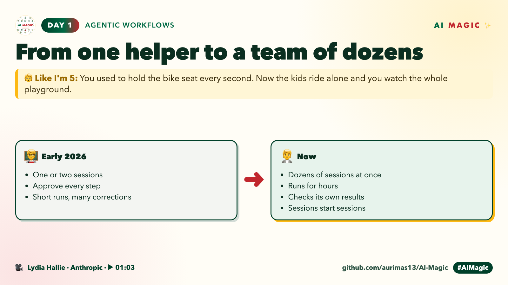

# Day 1 - From one helper to a team of dozens

**Date:** 2026-11-23 · **Level:** Medium · **Theme:** Agentic workflows

**Source:** [Rethinking Claude Code Best Practices — Lydia Hallie, Anthropic](https://www.youtube.com/watch?v=vlfCjWuv4es) - AI Engineer · lesson 1 from this talk

> 🧒 **Like I'm 5:** You used to hold the bike seat every second. Now the kids ride alone and you watch the whole playground.

## ⏱️ Where it is said

- [▶ 01:03](https://www.youtube.com/watch?v=vlfCjWuv4es&t=63s) - Sessions now run by the dozen, for hours, verifying themselves; humans become managers
- [▶ 00:00](https://www.youtube.com/watch?v=vlfCjWuv4es&t=0s) - Earlier models stopped sooner and needed constant correction
- [▶ 01:03](https://www.youtube.com/watch?v=vlfCjWuv4es&t=63s) - Anthropic: about 2,500 changes a day in May to more than 30,000 a day in September

Timestamps mark the start of the caption block where the point is made, so it can begin a few seconds in.

## 📚 The lesson

- Earlier models stopped sooner and needed repeated reminders and corrections (▶ 00:00)
- Today's sessions run for hours, in parallel, and verify their own results (▶ 01:03)
- Some sessions orchestrate other sessions (▶ 01:03)
- Anthropic reported going from about 2,500 changes a day in May to more than 30,000 a day in September (▶ 01:03)

**Why it matters:** When one person can run dozens of agents, the bottleneck is no longer typing. It is how well you can trust work you did not watch being done. The rest of this talk is about earning that trust.

**Try it yourself:** Count how many times you approve or correct your agent in one session today. Each one is a step you will later hand to the model, the harness or the environment.

## 🔤 Words, explained simply

| Term | Like I'm 5 |
|---|---|
| Session | One running conversation with a coding agent, with its own task and context. |

🤝 <b>AI collaboration:</b> researched, drafted and illustrated with Claude Code; reviewed, edited and approved by me before publishing - see <a href="../README.md#-ai-collaboration">AI Collaboration</a>.
