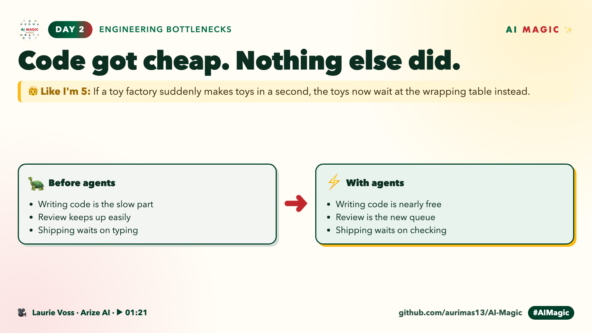

# Day 2 - Code got cheap. Nothing else did.

**Date:** 2026-11-24 · **Level:** Medium · **Theme:** Engineering bottlenecks

**Source:** [AI Writes the Code. So What's Left for Engineers? - Laurie Voss, Arize AI](https://www.youtube.com/watch?v=kspZP5BgkEU) - AI Engineer · lesson 1 from this talk

> 🧒 **Like I'm 5:** If a toy factory suddenly makes toys in a second, the toys now wait at the wrapping table instead.

## ⏱️ Where it is said

- [▶ 01:21](https://www.youtube.com/watch?v=kspZP5BgkEU&t=81s) - Agents made writing code basically free; what comes after did not get faster
- [▶ 01:46](https://www.youtube.com/watch?v=kspZP5BgkEU&t=106s) - First new bottleneck is code review; more bottlenecks follow until one sticks

Timestamps mark the start of the caption block where the point is made, so it can begin a few seconds in.

## 📚 The lesson

- Agents made writing code basically free; you pay for tokens, but relative to human time it is close to zero (▶ 01:21)
- Everything after writing code did not become free at the same time, so the bottleneck moved (▶ 01:30)
- The current bottleneck is code review; the talk predicts a chain of further bottlenecks (▶ 01:46)
- Whatever bottleneck agents cannot get past is what is left for humans to do (▶ 02:09)

**Why it matters:** When one step in a process gets dramatically faster, the work does not disappear; it waits at the next step. Knowing that helps you predict where your team will feel pain after adopting agents.

**Try it yourself:** list the steps your code goes through after it is written (review, tests, deploy, monitoring) and guess which one would jam first if you produced eight times more code.

## 🔤 Words, explained simply

| Term | Like I'm 5 |
|---|---|
| Bottleneck | The slowest step in a line of steps; everything else waits for it, like one narrow door out of a busy room. |

🤝 <b>AI collaboration:</b> researched, drafted and illustrated with Claude Code; reviewed, edited and approved by me before publishing - see <a href="../README.md#-ai-collaboration">AI Collaboration</a>.
