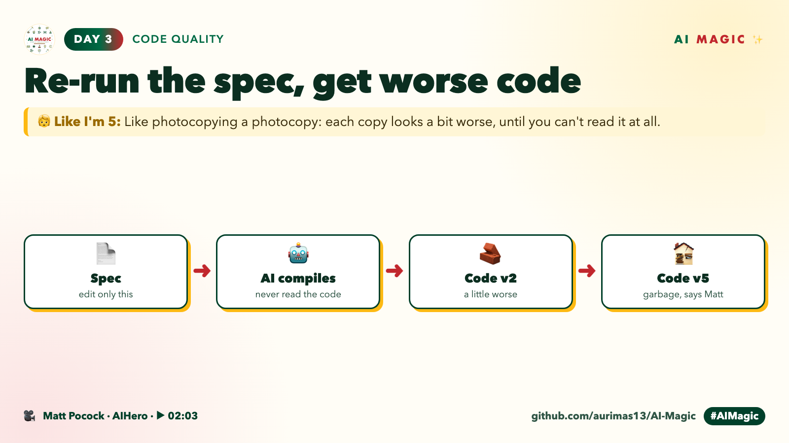

# Day 3 - Re-run the spec, get worse code

**Date:** 2026-11-25 · **Level:** Medium · **Theme:** Code quality

**Source:** ["Software Fundamentals Matter More Than Ever" — Matt Pocock](https://www.youtube.com/watch?v=v4F1gFy-hqg) - AI Engineer · lesson 1 from this talk

> 🧒 **Like I'm 5:** Like photocopying a photocopy: each copy looks a bit worse, until you can't read it at all.

## ⏱️ Where it is said

- [▶ 02:03](https://www.youtube.com/watch?v=v4F1gFy-hqg&t=123s) - Each re-run gave worse code; it is vibe coding by another name
- [▶ 00:00](https://www.youtube.com/watch?v=v4F1gFy-hqg&t=0s) - The specs-to-code idea: change only the spec and recompile with AI, never read the code
- [▶ 02:03](https://www.youtube.com/watch?v=v4F1gFy-hqg&t=123s) - Software entropy: changes made without thinking about the whole design decay a codebase

Timestamps mark the start of the caption block where the point is made, so it can begin a few seconds in.

## 📚 The lesson

- Specs-to-code: write a spec, have AI turn it into code, and fix problems by editing the spec and re-running (▶ 00:00).
- Matt Pocock tried it without looking at the code; each run produced worse code (▶ 02:03).
- He calls ignoring the code 'vibe coding by another name'.
- The Pragmatic Programmer's 'software entropy': changes that only consider themselves, not the system, make a codebase worse.

**Why it matters:** If AI writes most of the code, entropy compounds faster, so someone still has to care about the design.

**Try it yourself:** Regenerate one small module from its spec twice and diff the results. Is v2 easier or harder to change?

## 🔤 Words, explained simply

| Term | Like I'm 5 |
|---|---|
| Software entropy | The natural slide of a codebase into mess when every change ignores the bigger design. |
| Vibe coding | Letting AI write code you never read or understand. |

🤝 <b>AI collaboration:</b> researched, drafted and illustrated with Claude Code; reviewed, edited and approved by me before publishing - see <a href="../README.md#-ai-collaboration">AI Collaboration</a>.
