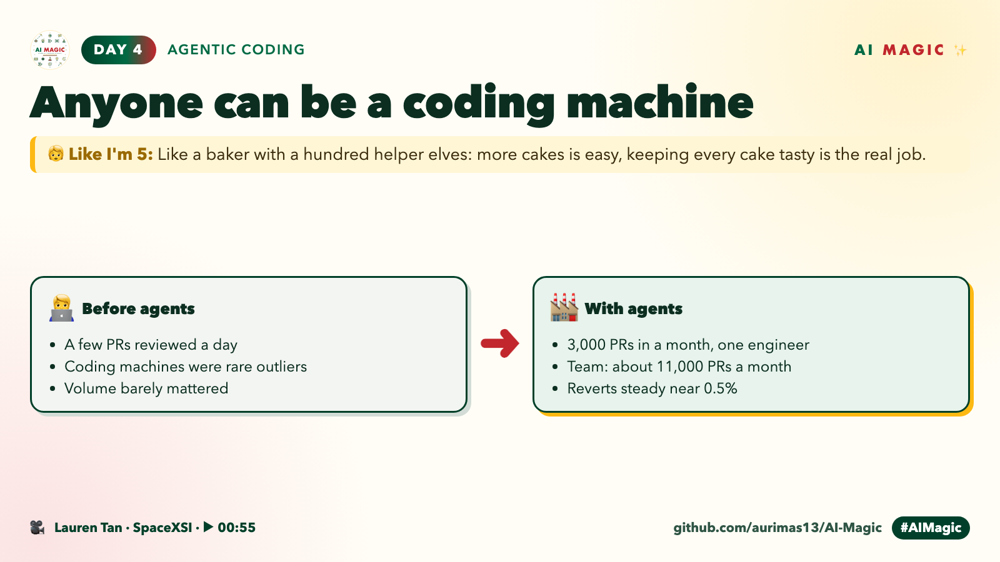

# Day 4 - Anyone can be a coding machine

**Date:** 2026-11-26 · **Level:** Medium · **Theme:** Agentic coding

**Source:** [All Code Is Slop (Except Mine) — Lauren Tan, SpaceXSI](https://www.youtube.com/watch?v=O_zcc6Xl12g) - AI Engineer · lesson 1 from this talk

> 🧒 **Like I'm 5:** Like a baker with a hundred helper elves: more cakes is easy, keeping every cake tasty is the real job.

## ⏱️ Where it is said

- [▶ 00:55](https://www.youtube.com/watch?v=O_zcc6Xl12g&t=55s) - She shipped 3,000 pull requests to production in one month
- [▶ 00:55](https://www.youtube.com/watch?v=O_zcc6Xl12g&t=55s) - With agents anyone can now be a 'coding machine'
- [▶ 13:03](https://www.youtube.com/watch?v=O_zcc6Xl12g&t=783s) - Her team shipped about 11,000 PRs in a month; reverts steady at about half a percent

Timestamps mark the start of the caption block where the point is made, so it can begin a few seconds in.

## 📚 The lesson

- She shipped 3,000 pull requests to production in one month with agents, many in her sleep (▶ 00:55).
- Her thesis: the engineer's job is maintaining or improving quality while massively increasing productivity (▶ 00:55).
- It took her six months of investment to get there, and she says it will take others much less (▶ 00:55).
- Her team shipped about 11,000 PRs in a month, with reverts steady at about 0.5% (▶ 13:03).

**Why it matters:** Throughput is cheap now, so it stops being a signal of skill. What separates teams is whether quality survives the volume.

**Try it yourself:** Count your own merged PRs and reverts for the last month. The revert rate is the honest quality number to watch as agent output grows.

## 🔤 Words, explained simply

| Term | Like I'm 5 |
|---|---|
| Pull request (PR) | A proposed change to code that others check before it joins the main project. |
| Revert | Undoing a change after it shipped because it broke something. |

## ❓ Not verified

Heard in the talk but not verified, so not explained here:

- SpaceXSI - the org as written in the verified YouTube title; another talk's title says SpaceXAI, so the exact name is unconfirmed

🤝 <b>AI collaboration:</b> researched, drafted and illustrated with Claude Code; reviewed, edited and approved by me before publishing - see <a href="../README.md#-ai-collaboration">AI Collaboration</a>.
