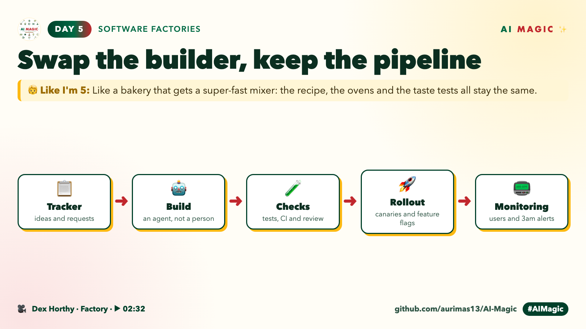

# Day 5 - Swap the builder, keep the pipeline

**Date:** 2026-11-27 · **Level:** Medium · **Theme:** Software factories

**Source:** [12 Rules for a Software Factory That Doesn't Ship Slop — Dex Horthy, Factory](https://www.youtube.com/watch?v=-NFMsM2y0Vk) - AI Engineer · lesson 1 from this talk

> 🧒 **Like I'm 5:** Like a bakery that gets a super-fast mixer: the recipe, the ovens and the taste tests all stay the same.

## ⏱️ Where it is said

- [▶ 02:32](https://www.youtube.com/watch?v=-NFMsM2y0Vk&t=152s) - Factory mindset: standardise the process, not just the output
- [▶ 02:32](https://www.youtube.com/watch?v=-NFMsM2y0Vk&t=152s) - Tracker, build, tests, PR, CI, rollout, users, monitoring: around for 30 years
- [▶ 02:32](https://www.youtube.com/watch?v=-NFMsM2y0Vk&t=152s) - To make it agentic, an agent builds the thing instead of someone

Timestamps mark the start of the caption block where the point is made, so it can begin a few seconds in.

## 📚 The lesson

- Software factories are just good engineering, in Dex Horthy's words (▶ 02:32).
- The factory mindset is about standardising the process, not just the output.
- The pre-AI factory: tracker, build, tests, pull request, CI, canaries and feature flags, users, monitoring (▶ 02:32).
- Making it agentic replaces only 'someone builds the thing' with 'an agent builds the thing'.

**Why it matters:** It shrinks a buzzword into something familiar: you already know most of the parts. The work is wiring agents into a pipeline that already has checks, not inventing a new one.

**Try it yourself:** draw your team's path from idea to production as boxes, then circle the one box an agent would take over. Notice how many boxes stay the same.

## 🔤 Words, explained simply

| Term | Like I'm 5 |
|---|---|
| Canary release | Showing a change to a few users first, like testing the bath water with one toe. |
| CI | Continuous integration: robots that run the checks every time someone pushes code. |

🤝 <b>AI collaboration:</b> researched, drafted and illustrated with Claude Code; reviewed, edited and approved by me before publishing - see <a href="../README.md#-ai-collaboration">AI Collaboration</a>.
