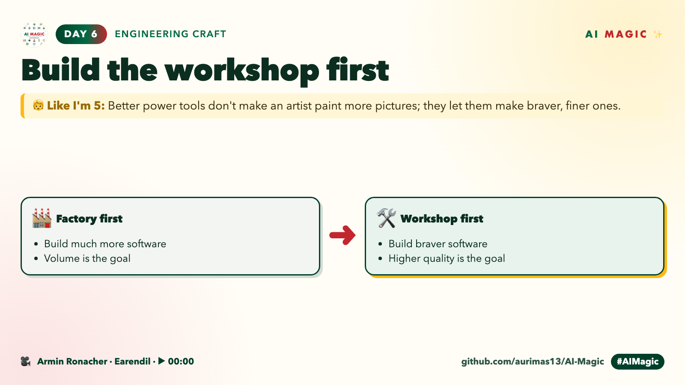

# Day 6 - Build the workshop first

**Date:** 2026-11-28 · **Level:** Medium · **Theme:** Engineering craft

**Source:** [Build the Workshop Before the Software Factory — Armin Ronacher, Earendil](https://www.youtube.com/watch?v=JNexz3Tbiu8) - AI Engineer · lesson 1 from this talk

> 🧒 **Like I'm 5:** Better power tools don't make an artist paint more pictures; they let them make braver, finer ones.

## ⏱️ Where it is said

- [▶ 00:00](https://www.youtube.com/watch?v=JNexz3Tbiu8&t=0s) - Make the case for building the atelier or workshop before the software factory
- [▶ 00:00](https://www.youtube.com/watch?v=JNexz3Tbiu8&t=0s) - Great tools can raise an artist's ambition; software can work the same way
- [▶ 00:00](https://www.youtube.com/watch?v=JNexz3Tbiu8&t=0s) - Less about building much more software, more about ambitious, high-quality software

Timestamps mark the start of the caption block where the point is made, so it can begin a few seconds in.

## 📚 The lesson

- Armin Ronacher makes the case for building the atelier or workshop before the software factory (▶ 00:00).
- His comparison: an artist with CNC machines, 3D printers and good power tools can raise the ambition of their art (▶ 00:00).
- Applied to software, the goal is less about building much more software and more about building more ambitious, high-quality software (▶ 00:00).
- He notes that what we can do with agents is on an exponential curve (▶ 00:00).

**Why it matters:** Most talk about agents measures output: more commits, more pull requests, more apps. Framing agents as workshop tools changes the question from 'how much more can we ship?' to 'what better thing can we now attempt?'

**Try it yourself:** pick one project you would never have attempted alone and write one sentence on what 'higher quality' would mean for it before you ask an agent for anything.

## 🔤 Words, explained simply

| Term | Like I'm 5 |
|---|---|
| Atelier | An artist's workshop: the room where the tools live and careful work gets made. |
| Software factory | A setup where agents turn a steady stream of tasks into shipped code with little human help. |

🤝 <b>AI collaboration:</b> researched, drafted and illustrated with Claude Code; reviewed, edited and approved by me before publishing - see <a href="../README.md#-ai-collaboration">AI Collaboration</a>.
